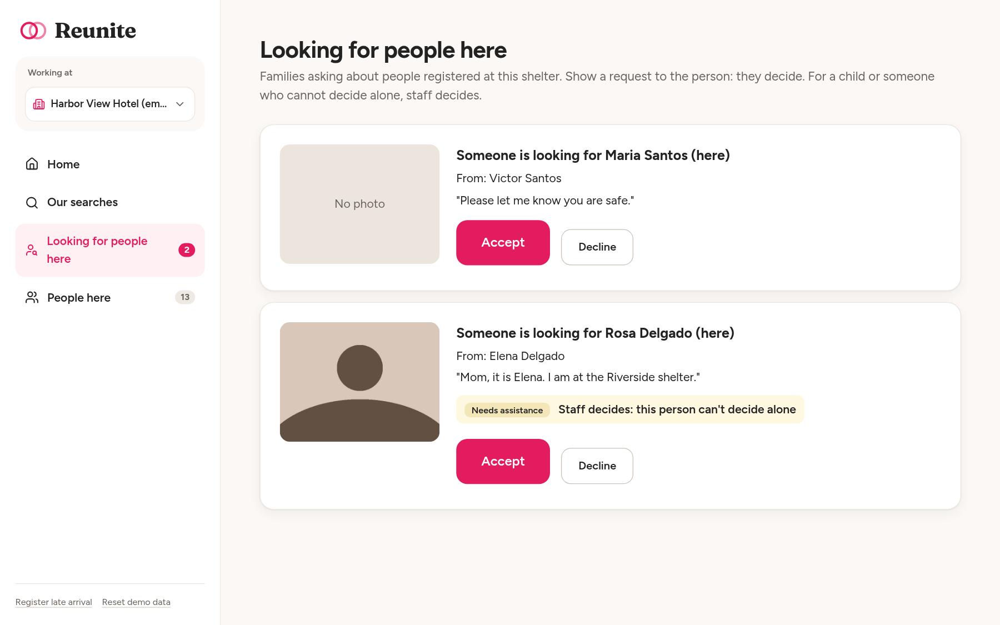
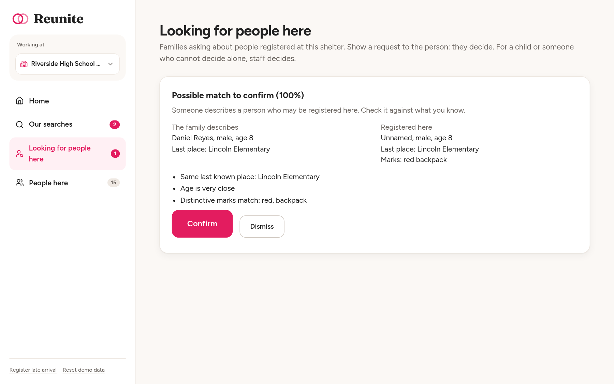
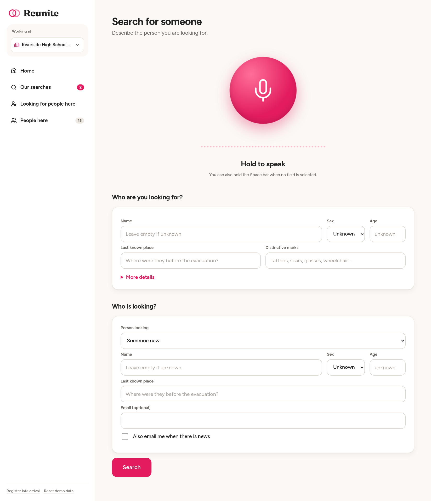
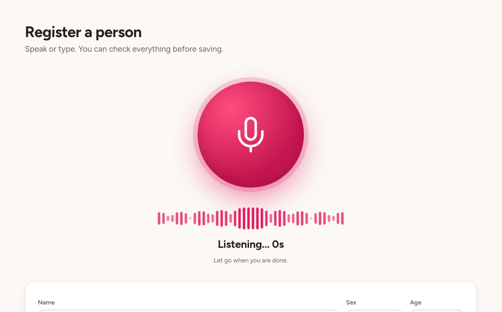
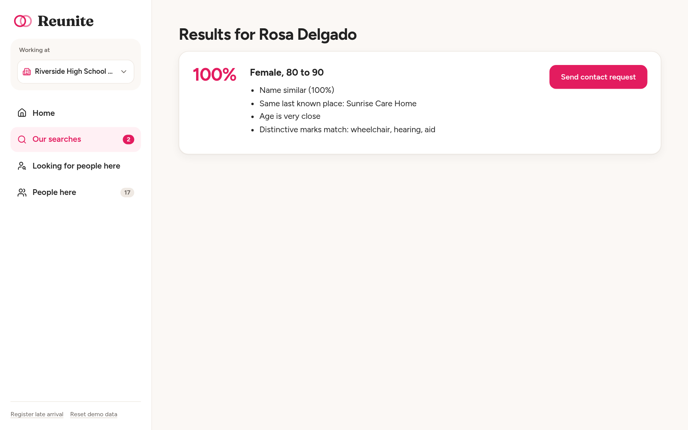

# Reunite

A web app for volunteers in evacuation shelters to help separated families find each other, without exposing anyone who does not want to be found.

Built for the DALI Lab challenge "Reuniting Separated Families".

Live demo: https://dali.bruno.com.es

## Overview

A hurricane forces about 400,000 people to leave a coastal region with two days of warning. People end up in dozens of shelters, hotels and relatives' homes, and thousands of families are separated.

Reunite is the tool a tired shelter volunteer would have open on a laptop at 2 a.m. They can:

- **Register** people who are in their shelter, by speaking or typing.
- **Search** for a missing family member on behalf of the family standing at the desk.
- **Get alerts** when a new arrival looks like someone a family is searching for.
- **Pass on contact requests**, so the person being sought decides whether to be found.

Three ideas make it different from a name search:

1. **Places, not just names.** People are often found by where they were. Besides describing the person, we record the last place they were known to be (a school, a care home, a street). Matching uses that place even when there is no name, so a child who cannot say his name can still be connected to the school his mother is asking about.
2. **Reciprocal search.** If A searches for B and B searches for A, that is the strongest signal, and the flow gets shorter.
3. **Voice entry.** Hold a microphone button and speak, in any language. The AI fills the form, marks what it is unsure of in yellow, and the volunteer reviews before saving.

One rule runs through everything: **nobody sees another person's location until that person accepts contact.**

### Try it

Open the live demo. There is no login: use the shelter selector at the top of the sidebar to act as any shelter. The app only holds fake data. Open two browser windows (for example one normal and one private) to play two shelters at once. The sidebar is organised by direction: "Our searches" are the people this shelter is looking for, "Looking for people here" are families asking about people registered at this shelter. Each item shows a count when something is waiting. The seeded cases are:

| Case | Where to look |
|---|---|
| An 8-year-old from Lincoln Elementary, registered without a name. His mother searches from another shelter. | Only the last known place, his age and his red backpack connect them, so the match waits at the child's shelter (Riverside) under "Looking for people here" as a "Possible match to confirm". Confirm it there and the mother's search at St. Mary's lights up in "Our searches". |
| An 81-year-old mother moved out of a care home by another agency, flagged "needs assistance". Her daughter is searching. | At Riverside, "Our searches" shows the daughter's search highlighted. Send a contact request from its results: it goes to Harbor View Hotel, where she is, labelled "Staff decides: this person can't decide alone". No other shelter sees it. |
| A couple searching for each other. | Riverside and St. Mary's both see their search highlighted with a Reciprocal badge. Both directions score 85% or more, so their request needs no photo. |
| A person registered under an alias ("Mr. Blue"). | Riverside's open search for "Tomas Ferrer" finds him through marks and place, with a lower score. |
| A person who will decline contact. | At Harbor View Hotel, open "Looking for people here" and decline. At Riverside, the search card in "Our searches" still says "Request sent. Pending confirmation." |
| A husband rescued later. | Keep Harbor View's window open. At the bottom of the sidebar press "Register late arrival". His wife's search lights up in "Our searches" within 15 seconds. |

"Reset demo data", next to it, puts everything back.

### Screenshots

**Home** is two large buttons. The sidebar is organised by direction, with a count on every item that has something waiting.


**Our searches** has one card per search from this shelter, phrased "Elena Delgado (here) is looking for Rosa Delgado". Each card shows where its search stands: no matches yet, possible match, request sent, or reunited with the location. Cards with something new are highlighted.


**Looking for people here** holds everything others started about people registered at this shelter, and only this shelter sees it. A request for a child or someone who cannot decide alone is marked "Staff decides: this person can't decide alone", and a match where a name is missing appears as a "Possible match to confirm" with Confirm and Dismiss.



**Possible match to confirm.** A strong match where a name is missing goes to the shelter where the registered person is, because only staff there can tell whether it fits. Confirm alerts the family's shelter. Dismiss tells nobody.



**Search** starts with the microphone and the new-search form.



**Register with voice.** Hold the big microphone and speak in any language. Green fields were heard clearly, yellow ones need a check, and the transcript is shown only while you review.


**While recording** the button pulses softly and a live waveform follows the voice.



**Search results** show a score and plain reasons, never a name or a shelter.



The photo in these screenshots is a neutral stand-in from a fake camera. All names are demo data.

[TODO: add team names, DALI submission details and a demo video link, if any.]

## The full picture

### What was built

- Register people and search for them, with a form and with voice input.
- Matching on name, last known place, age, distinctive marks, height and hair, with plain-language reasons.
- Reciprocal search: only when both searches describe each other at 85% or more.
- A consent flow for contact requests: photo, a short message, accept or decline.
- "Our searches": one card per search, with its status, best score, sent request and reunion in one place. "Looking for people here": everything others started about people registered at this shelter, and only this shelter sees it: contact requests (staff decides for minors and people who cannot decide alone) and possible matches to confirm.
- Automatic alerts: a new match highlights the card of its search. Counts in the sidebar refresh every 15 seconds.

### What is simulated on purpose

- **Accounts.** There is no login and no password. The sidebar lets anyone pick a shelter. This is a placeholder for real accounts.
- **Email and SMS.** "Sending" saves a notification row, prints it to the server console and shows "Email sent to ..." in the UI. No provider is connected.

### What was not built, and how it would work

- **Scanning paper registers.** Some shelters keep paper lists. A volunteer would photograph a page, a vision model would read each row into the same person fields, and a volunteer would confirm the rows before they are saved. The same "doubtful fields in yellow" review as voice would apply.
- **Witness sightings.** People who saw someone ("an old woman in a wheelchair boarded the blue bus") could submit a sighting. It would be stored with a place and a time, matched like a last known place, and never shown to searchers directly.
- **Agency integration.** Transport companies, school districts and care-home operators could send their passenger or resident lists. The system would use them as extra evidence when matching by last known place, for example a bus that left a school.
- **SMS and a phone line.** Families without a phone could call a number, speak, and get a reference code. The voice pipeline already turns speech into fields, so a call would feed the same search. Notifications would go out as SMS.
- **Transport for reunification.** After an accepted contact, the two shelters could arrange a ride or a meeting point.
- **Status changes (transferred, left).** Out of scope for this prototype. A registered person is simply listed at the shelter where they were registered, and nobody can mark them as transferred or left. How it would work: each person gets a status (present, transferred, left). Marking someone as transferred records the destination shelter, and it could be set automatically when an agency's list already names them. The person then appears in the destination shelter's list, and their open searches and alerts follow them there. A person who has left stays in the history but is no longer offered as a match. Every change would go into an audit log. Consent would carry on across a move: a pending contact request would be re-routed to the shelter where the person now is, and nothing about the new shelter would be shown until they accept.
- **Working offline.** Shelters lose connectivity. A local-first version could keep registrations on the laptop and sync when the network returns. This app needs a connection.

## Design

### Users

- **Shelter volunteer** is the main user, on a shelter laptop. They are not technical and they are overloaded.
- **Family member searching** does not use the app. They talk to the volunteer at the desk.
- **Person being sought** does not use the app either. The volunteer shows them the request and they decide.

The test for each screen was: can an exhausted volunteer with a queue in front of them understand it in 3 seconds? Each screen has one large main action, and secondary actions are small and quiet. The longer reasoning is in `DESIGN.md`.

### Why this part

[TODO: write your own reasons for choosing this problem and this slice of it. Suggested angle: finding people is partly a data problem, but the hard part is consent and safety, which is why the design is built around who is allowed to see what.]

### Edge cases the design handles

- **No phone.** The family member is registered at the shelter as a searcher in the same step as the search. Nothing is needed from their device. Email is optional.
- **No ID.** Matching does not depend on documents. It uses description and last known place.
- **Aliases and fear of giving a real name.** A name can be an alias or "unknown", with a checkbox "This may not be their real name". No immigration or legal status field exists anywhere, and the voice prompt tells the AI never to record it.
- **A shelter deciding its own request.** A shelter can never accept or decline a request it sent, and the API refuses it too. It only sees that request in "Our searches" as "Request sent. Pending confirmation." If the person asked about is at the same shelter, the request shows in both places, as "Elena Delgado (here) is looking for Rosa Delgado (also here)", and is decided there.
- **Minors.** Under 18 is flagged automatically. Their contact requests go to the shelter where they are, labelled "Staff decides: this person can't decide alone", and the volunteer there decides for them.
- **People who cannot decide (for example dementia).** A "needs assistance" flag works the same way: the request goes to their shelter and staff decides.
- **Matches without a name.** A strong match where a name is missing (a child who cannot say his name) is not alerted automatically. The shelter where the registered person is sees it as a "Possible match to confirm" with Confirm and Dismiss, because only staff there can tell whether it fits. No other shelter sees it.
- **Declines that cannot be told apart.** After "Decline", the search card still says "Request sent. Pending confirmation.", exactly as if nobody had answered. Later requests from the same searcher to the same person, even from a new search, are dropped silently and also look pending.
- **Noise.** Voice recording asks the browser for noise suppression and echo cancellation. The form is always there as a backup.
- **Badly transcribed names.** The AI marks uncertain values as low confidence, and they turn yellow with "Please check". The volunteer can fix any field by typing, and the transcript is shown during review.
- **Duplicates.** Places autocomplete from existing places so there are not ten spellings of one school. Registering the same person twice is not detected (see limitations).
- **Someone who does not want to be found.** Search results never show the candidate's name or shelter, and a decline is final from the searcher's point of view.

## Privacy

- **No audio is stored.** The recording goes to the server in memory, to the transcription service (OpenAI), and is discarded. Nothing is written to disk.
- **Transcripts are not stored or logged.** The text is shown to the volunteer during review only.
- **Voice input sends data to outside providers.** The audio goes to OpenAI for transcription. The transcript text (never the audio) goes to the extraction provider, DeepSeek, which processes data outside the United States. Use voice input only with data you are allowed to send there. Without the two API keys, no data leaves the server.
- **Photos are deleted** as soon as a contact request is accepted or declined. While they exist they are never served as static files. Only a shelter that may decide the request can fetch them, through a checked endpoint. The sending shelter cannot.
- **Location only after accepting.** Search results show sex, an age range and the reasons for the match. The name and shelter appear only after the other person accepts.
- **No immigration status** field or question exists.
- **Access checks on every route.** A test calls every API route with no session and with a session, and checks the exact status code. A new route that is not in that test fails the test suite.
- **Responses are never cached,** and in production the session cookie is `Secure`, `HttpOnly` and `SameSite=Lax`.

## Technical choices

- **Backend:** Node.js with Express, plain JavaScript. **Database:** SQLite through `better-sqlite3`, one file, one `schema.sql`.
- **Frontend:** React with Vite and React Router, one CSS file with variables. No TypeScript, no UI library, no state manager. Icons from `lucide-react`. The fonts (Figtree for the interface, Fraunces for the logo) are self-hosted through npm, so no visitor's browser contacts a third party.
- **Matching:** one readable file, `server/matching.js`, with pure functions: Jaro-Winkler on name tokens, last known place, age, marks keywords, height and hair. Missing data is never penalised, and a lone matching field cannot look like a certain match.
- **Voice:** the browser records with `MediaRecorder`; OpenAI transcribes; DeepSeek extracts the fields through a forced function call with a JSON schema (its thinking mode is switched off, because DeepSeek rejects a forced tool choice in thinking mode). The server validates every value against the form's allowed values, so a wrong answer from the model never reaches the form unchecked.
- **Sessions:** `express-session` with the default in-memory store. Simple, but sessions are lost on restart and only one process can run.
- **Production:** one Express process serves the API and the React build, managed by PM2, behind nginx with a Let's Encrypt certificate.

### Tradeoff 1: privacy against speed

Asking for consent delays reunions that would have been harmless. A mother could see where her child is right away; instead she waits for a volunteer to show a request. We accept that delay on purpose, because revealing the location of someone who is hiding from an abuser cannot be undone, and a slower reunion can. Having staff at the person's own shelter decide for minors and people who cannot decide alone, and confirm matches where a name is missing, adds a further delay for the same reason. The one shortcut is a reciprocal match: both searches describe each other at 85% or more, so no photo is needed, because both people have already asked for each other.

### Tradeoff 2: simple, but not built for 400,000 people

SQLite and matching in JavaScript are easy to read and run anywhere, but they would not scale to a real evacuation. Every new person is compared with every open search, narrowed only by a SQL filter on sex and age. At real scale this needs proper indexes, blocking keys (for example a phonetic key for names) before scoring, a job queue instead of matching inside the request, a server database, and shared session storage.

## Limitations

- A person who was declined could register again under a different name at another shelter and look like a new searcher. The "dropped after decline" rule works per searcher and per found person, so without identity documents we cannot fully prevent this.
- Registering the same person twice at different shelters is not detected.
- There is no authentication. Anyone can act as any shelter, so the privacy rules protect against honest mistakes, not against someone who deliberately switches shelter. Real use needs real accounts.
- There are no status changes, so a person who moves on stays listed at the shelter where they were registered. An accepted reunion could send a family to a shelter the person has already left.
- Voice input has so far been tested only against mocked OpenAI and DeepSeek services. [TODO: add real-speech test results.]

## How to run locally

You need Node.js (developed and tested on version 24).

```bash
git clone <this repository>
cd reunite

# Install the dependencies, then create .env with a random session secret
npm install --prefix server
npm install --prefix client
npm run setup --prefix server
# Optional: put your OPENAI_API_KEY and DEEPSEEK_API_KEY in .env to turn on voice input.
# Without them the microphone says "Voice input is not configured" and the forms still work.

# Option A: production-like, one process on http://localhost:3100
npm run build --prefix client
npm start --prefix server

# Option B: development with hot reload on http://localhost:5173
npm start --prefix server            # in one terminal
npm run dev --prefix client          # in another
```

The first start creates `server/data/reunite.db` and fills it with demo data. To start over, press "Reset demo data" at the bottom of the sidebar, or delete the file.

Run the tests with `npm test --prefix server`.

### Environment variables

| Name | Meaning |
|---|---|
| `PORT` | Port to listen on (default 3100). |
| `SESSION_SECRET` | Generated by `npm run setup`. |
| `DEEPSEEK_API_KEY`, `DEEPSEEK_MODEL` | Field extraction from speech (default model `deepseek-flash`). |
| `OPENAI_API_KEY`, `OPENAI_TRANSCRIBE_MODEL` | Speech transcription. |

### Deployment notes

The live demo runs as a single PM2 process (`reunite`, defined in `ecosystem.config.cjs`) on `127.0.0.1:3100`, behind nginx with a Let's Encrypt certificate. Keep it to one instance, because sessions live in memory. After changing `.env`, restart the process so the new values are read.
