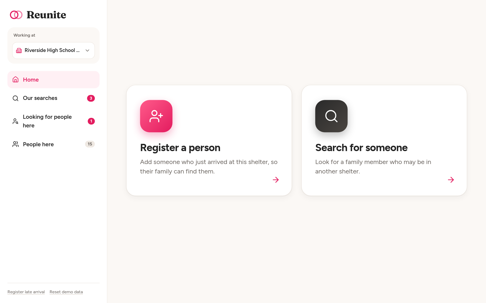
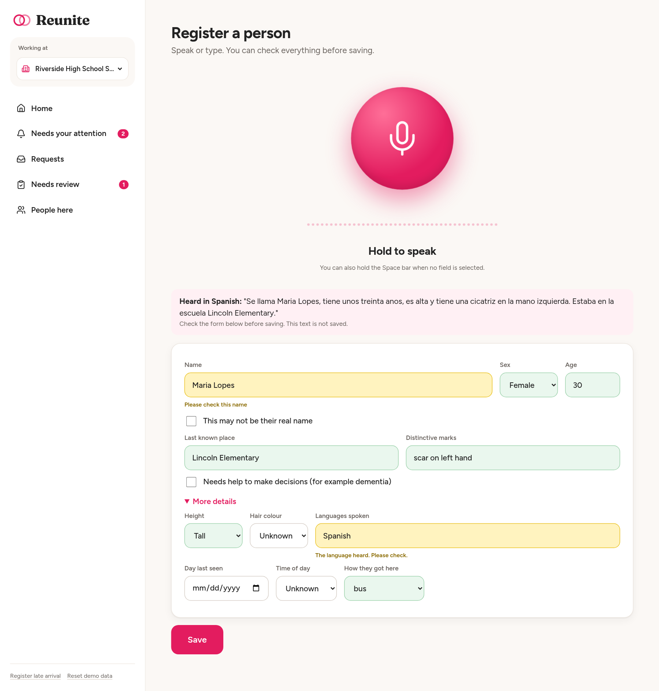
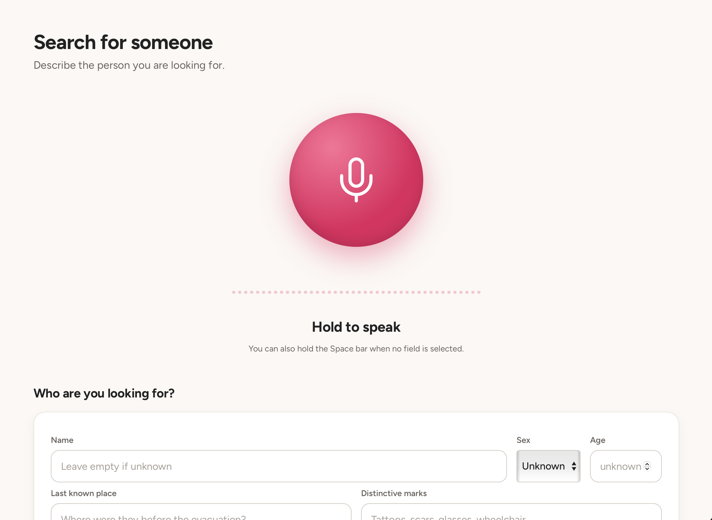
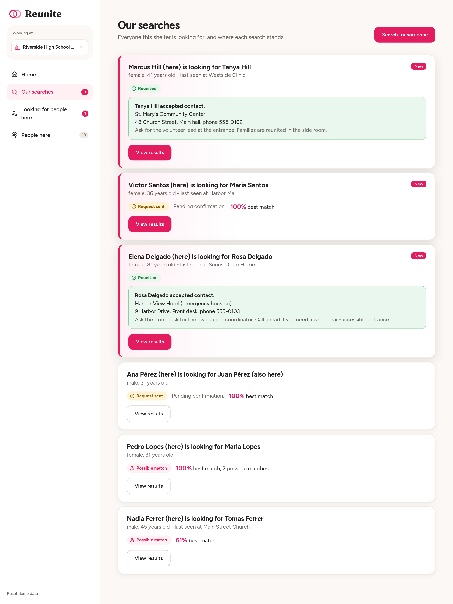
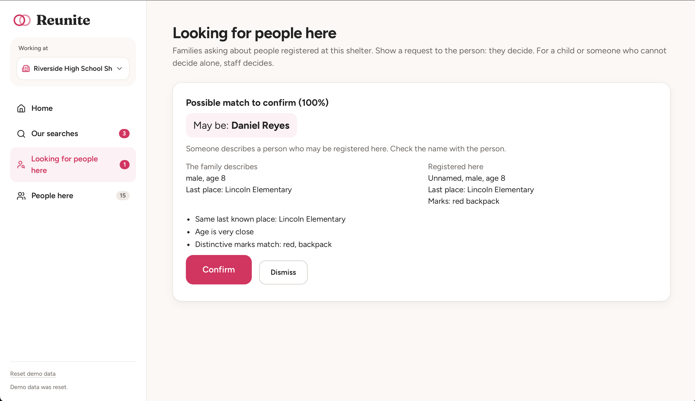

# Reunite

Reunite helps shelter volunteers reunite families separated during a hurricane evacuation. A volunteer registers the people who arrive at their shelter and searches on behalf of relatives who are looking for someone. The app finds likely matches across all shelters and only connects two people when the person who was found says yes.

**Live demo:** https://dali.bruno.com.es
**Repository:** https://github.com/BrunoGzz/reunite

No login is needed. Pick a shelter in the sidebar and you are a volunteer there. Switch shelters to see the other side of a match.

---

## The full picture

### The problem as I see it

Searching a database is the easy part. The hard parts are:

1. **Getting people into the system.** At 2 a.m. a volunteer has a line of worried families, no IDs, half the people have no phone, and some records are on paper. If registering someone takes five minutes, the data never gets in.
2. **Connecting people without putting anyone in danger.** Some people do not want to be found by a specific person. A system that tells anyone where someone is would be dangerous for a person escaping an abusive partner.

So I built the core loop around those two things: fast intake by voice, and matching with consent before anything is revealed.

### What I built

- **Register a person** who is at this shelter, by voice or by form.
- **Search for someone** on behalf of a relative who is at this shelter.
- **Matching** across all shelters, with a similarity score and plain-language reasons ("Name similar", "Same last known place", "Distinctive marks match: glasses").
- **Searches that stay open.** When someone new is registered anywhere and matches an open search, the searcher's shelter is alerted. This covers the spouse who was rescued two days later.
- **Contact requests with a photo.** The searcher's photo and a short message go to the found person's shelter. The found person sees who is looking for them and decides.
- **Decisions stay where the person is.** Requests for minors and people who can't decide alone are decided by staff at their shelter, who can see them in person. Matches with no name are confirmed by that same staff before anyone is alerted.

### How the app is organized

The app is organized by direction:

- **Our searches:** people at this shelter looking for someone. One card per search with its status: no matches yet, possible match, request sent, reunited.
- **Looking for people here:** people from outside looking for someone at this shelter. Incoming requests, and matches staff need to confirm.
- **People here:** everyone registered at this shelter.

### What I did not build, and how it would work

- **Paper records.** An AI could scan the paper records and translate the raw data into valuable information ready to insert into the database.
- **Status changes.** People leave shelters or get transferred. In production each registration would have a status (here, transferred to X, left) so a reunion never sends a family to the wrong place.
- **Real notifications.** Email is simulated in the UI. In production it would also send SMS to people who still have a phone.
- **Authentication and roles.** Real volunteer accounts per shelter, and a coordinator role for sensitive decisions.
- **Integrations** with the agencies that moved people (schools, nursing homes, rescue teams) so their lists come in directly.

### Where my piece fits

Reunite is the part that runs inside each shelter: intake, search, matching and consent. Everything above either feeds data into it (agency lists, paper records) or carries its result out (notifications, transport to reunite).

---

## Design

### Users

- **Shelter volunteer (main user).** Not technical, tired, using a shared laptop. Needs to register someone in under two minutes and understand every screen at a glance.
- **Family member searching.** Does not use the app. Talks to the volunteer at the desk. Might have no phone and no ID.
- **Person being searched for.** Does not use the app either. When a request arrives, the volunteer at their shelter shows them the photo and they decide.

### Why voice

Typing a description while someone is crying in front of you is slow. Saying "she's around 80, uses a walker, was at Sunrise Care Home" is fast. The volunteer holds the button and talks (or the family member talks, in their own language), and the AI fills the form. The volunteer always reviews before saving.

- Fields the AI was sure about get a light border. Uncertain ones turn yellow with "Please check". Names are often mis-transcribed, so they get flagged.
- The AI never fills in something that was not said.
- Any language works. Descriptions are stored in English, names are kept as spoken.
- Shelters are noisy, so recording is push-to-talk with browser noise suppression, and the form always works without voice.

### Privacy rules

- **Nobody sees where anyone is** until that person accepts. Search results show a score, sex, an age range and the reasons for the match. Never a name or a shelter.
- **A decline looks exactly like no answer.** The searcher only ever sees "Pending confirmation". If they saw "declined", they would know the person is alive and in a shelter.
- **No retries after a decline.** Any later request from the same searcher to the same person is silently dropped, even from a new search.
- **The shelter that sends a request can never decide it.** Only the shelter where the person is can accept, decline or see the photo.
- **Aliases are allowed.** There is no ID field and no immigration status field.
- **No audio or transcripts are stored.** Photos are deleted once the request is decided.

### Edge cases

| Situation | How the design handles it |
|---|---|
| No phone | The shelter is the contact point. Alerts go to the shelter. Email is optional. |
| No ID | Identity comes from descriptions, the photo, and the found person's own decision. |
| Afraid to give a real name | Alias allowed, marked "may not be their real name". No immigration fields. |
| Doesn't want to be found by someone | The photo shows who is asking. Decline is invisible.|
| Abusive partner searching | Results never show location or name. Contact only happens after the victim accepts. |
| Child separated at school | Staff at the child's shelter decide, never the child alone. |
| Elderly parent with dementia | "Needs assistance" flag. Staff at their shelter decide. |
| Spouse rescued days later | Searches stay open and are re-checked against every new registration. |
| Misspelled names, two surnames in any order | Token-based fuzzy matching on names, accents removed. |
| Same name, different person (father and son) | A big age gap rules the match out. A name alone can't trigger an alert. |
| Two people searching for each other | Reciprocal match. If both directions score 85% or more no photo is needed. |
| Noisy shelter | Push-to-talk, noise suppression, review step. |
| Similar-looking strangers | Matches are always confirmed by a person. Accepting one request never closes other relatives' searches. |

---

## Technical choices

- **React (Vite) and Node/Express**, served from one process on my own VPS behind nginx with HTTPS.
- **SQLite** with `better-sqlite3`. One file, no database server, enough for a demo.
- **Matching in plain JavaScript** (`server/matching.js`), small pure functions with tests. Weights: name 35, last known place 25, age 15, distinctive marks 15, height and hair 10. If sex is known on both sides and differs, the score is 0. Missing fields don't penalize, but a match based on very few fields is scaled down so a name alone can't trigger an alert. Name tokens use Jaro-Winkler, and tokens below 0.8 count as zero so unrelated names don't get a baseline score.
- **Alerts** need 85% or more and a similar name. Matches with no name go to staff at the person's shelter first.
- **Voice:** OpenAI for transcription, DeepSeek for turning the transcript into form fields with a forced function call. Every value is validated on the server against the allowed options.
- **Polling every 15 seconds** instead of websockets. Simpler, and alerts don't need to be instant.
- **Tests** for matching, the consent rules, the voice validator, and a route test that calls every endpoint with and without a session.

### The biggest tradeoff: privacy over speed

The consent step slows down reunions that would be harmless. A mother who finds her son still has to wait for a volunteer at his shelter to show him her photo. I accepted that because the opposite mistake, revealing where someone is to the wrong person, can't be undone.

### Other tradeoffs and limitations

- **No authentication in the demo.** Anyone can act as any shelter, so the privacy rules protect against honest mistakes, not attackers.
- **SQLite and JavaScript matching won't scale to 400,000 people** without better indexing and pre-filtering.
- **Someone could re-register under a different name**. Without IDs this can't be fully prevented.
- **DeepSeek processes the transcript outside the United States.** For a real deployment I would use a provider with a clear data agreement.
- **Locations can go stale** because status changes (transferred, left) are not built.

---

## Try it

1. Pick a shelter and open **Our searches**. Find the one where Nora Whitaker is looking for Tom Whitaker (male, 58, last seen at Pelican Street). This is the spouse who stayed behind.
2. Switch to a different shelter and **register** Tom Whittaker (male, 58, last seen at Pelican Street). The misspelling is on purpose.
3. Switch back to Nora's shelter. Within 15 seconds her card in **Our searches** shows a possible match.
4. Open the results and send a contact request with a photo.
5. Switch to Tom's shelter and accept it in **Looking for people here**.
6. Switch back. Nora's card now shows where Tom is.

Try registering him with age 35 instead. He won't match, because he could be Tom's son.

Use **Reset demo data** in the sidebar to start over.

---

## How I worked with AI

I used Claude Code on my VPS to help me build and deploy the app. This README was drafted with Claude and edited by me.

- **Decisions I made.** Voice as the main input, a photo with every contact request, no case codes or opt-out flags, and cutting login, roles and group transfers when the app got too complex.
- **Reviewing every phase.** I pushed back when I disagreed. The reciprocal threshold was too low for a flow that skips the photo, and the block after a decline could be bypassed with a new search.
- **Testing it myself.** I found that the sender of a request could decide it, that one inbox mixed incoming and outgoing, and that requests for minors were visible to every shelter. Each led to a fix or a redesign.

---

## Contact

bruno.rodriguez.trejo.30@dartmouth.edu
